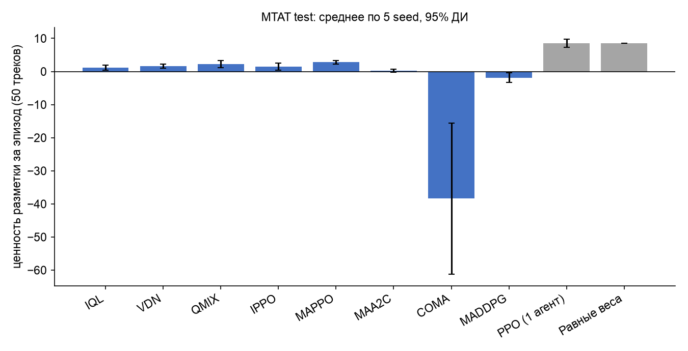
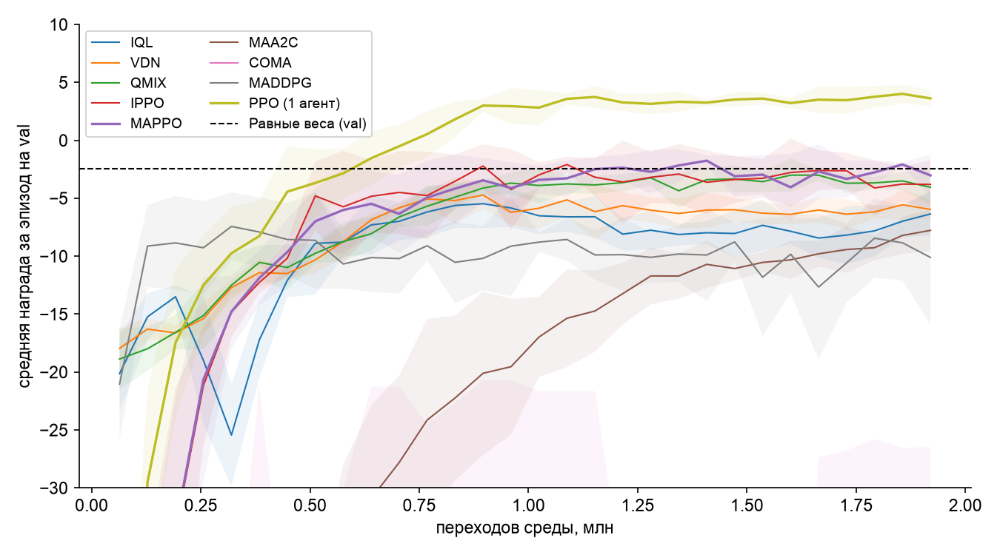

## 4. Единый экспериментальный протокол

| Элемент | Значение (одинаково для всех алгоритмов) |
|---|---|
| Набор «активов» (треков) | MTAT train (OOF-вероятности) для обучения; val, test, Jamendo — для оценки |
| Временное разбиение | train → val (выбор чекпойнта) → test → полностью отложенный Jamendo 2010–2017 |
| Бюджет взаимодействий | 600 итераций × 64 параллельных среды × 50 треков = **1,92 млн переходов** на запуск |
| Seed | 5 (0–4) для каждого алгоритма |
| Выбор чекпойнта | каждые 20 итераций по средней награде на val (128 эпизодов), тест при обучении не используется |
| Оценка | 256 эпизодов с **одним и тем же** seed для всех алгоритмов (общие случайные числа: одинаковые последовательности треков), детерминированные (greedy) политики |
| Доверительные интервалы | 95% t-интервал по 5 seed; парные сравнения — разность по seed и критерий Уилкоксона по эпизодам |
| Сети | MLP 2×64, ReLU; параметры разделяются между агентами (one-hot id во входе) |

### Таблица гиперпараметров

| Параметр | Значение | Где |
|---|---|---|
| γ / λ (GAE) | 0,99 / 0,95 | все |
| learning rate (Adam) | 5·10⁻⁴ | все |
| PPO: эпох / clip / коэф. энтропии | 4 / 0,2 / 0,01 | IPPO, MAPPO, PPO; MAA2C — 1 эпоха без clip; COMA — 4 эпохи |
| Value-based: батч / буфер / ε / target | 256 / 100 000 / 1,0 → 0,05 за 50% бюджета / каждые 200 шагов, double-Q | IQL, VDN, QMIX |
| QMIX: гиперсети | эмбеддинг смешивания 32, ELU, |w| ≥ 0 | QMIX |
| MADDPG: Gumbel τ / soft target | 1,0 / 0,01 | MADDPG |
| Эвристика: порог τ | 0,425 (подобран по val на сетке 0,30–0,95) | Равные веса |
| Клиппинг градиента | 1,0 (policy-gradient), 10 (value-based, MADDPG) | |

Журналы: `results/config_log.json`, `runs_meta.csv`, `learning_curves.csv`.

### Алгоритмы

| Алгоритм | Класс | Критик / смешивание |
|---|---|---|
| IQL | независимые Q-агенты (double DQN) | — |
| VDN | value decomposition | Q_tot = ΣQᵢ |
| QMIX | value decomposition | монотонная гиперсеть от s |
| IPPO | независимый PPO | V(oᵢ) |
| MAPPO | CTDE PPO | V(s, id) |
| MAA2C | CTDE actor-critic | V(s, id), без clip |
| COMA | CTDE, контрфактический baseline | Q(s, u₋ᵢ, id) |
| MADDPG | CTDE, Gumbel-softmax | Q(s, u) |
| **PPO (1 агент)** — контрольный | одна централизованная политика по полному состоянию, 4 головы действий | V(s) |
| **Равные веса** — контрольный | среднее вероятностей трёх модальностей; автометка, если max ≥ τ, иначе проверка | — |

## 5. Сравнение алгоритмов (MTAT test, 5 seed × 256 эпизодов)

«Ценность разметки» — суммарная награда за эпизод из 50 треков. Аналоги финансовых метрик: Sharpe = среднее / std по эпизодам, Sortino — по отрицательным эпизодам, CVaR 5% — среднее худших 5% эпизодов, просадка — максимальная просадка накопленной ценности по 256 эпизодам.

| Алгоритм | Ценность [95% ДИ] | Sharpe | Sortino | CVaR 5% | Max просадка | Точность каталога | Ошибка автометок | Доля проверок | Нарушения бюджета | Std по seed |
|---|---|---|---|---|---|---|---|---|---|---|
| IQL | 1,22 [0,46; 1,98] | 0,12 | 0,19 | −21,0 | −101 | 0,836 | 21,2% | 22,8% | 0,1% | 0,61 |
| VDN | 1,62 [1,00; 2,25] | 0,16 | 0,26 | −20,1 | −83 | 0,844 | 20,3% | 25,4% | 0,1% | 0,50 |
| QMIX | 2,23 [1,09; 3,37] | 0,23 | 0,38 | −19,0 | −74 | 0,854 | 19,8% | 26,5% | 0,1% | 0,92 |
| IPPO | 1,41 [0,34; 2,47] | 0,14 | 0,22 | −20,6 | −105 | 0,826 | 19,7% | 25,6% | 0,2% | 0,85 |
| **MAPPO** | **2,79** [2,20; 3,37] | **0,28** | **0,48** | −19,2 | **−67** | 0,829 | **19,3%** | 23,8% | 0,1% | **0,47** |
| MAA2C | 0,23 [−0,20; 0,66] | 0,02 | 0,03 | −21,1 | −211 | 0,845 | 21,0% | 27,1% | 0,3% | 0,35 |
| COMA | −38,4 [−61,2; −15,6] | — | — | −38,4 | −9 830 | 0,120 | — | 12,0% | 28,0% | 18,35 |
| MADDPG | −1,85 [−3,31; −0,39] | −0,18 | −0,21 | −23,2 | −541 | 0,840 | 22,2% | 28,3% | 0,2% | 1,18 |
| *PPO (1 агент)* | **8,50** [7,23; 9,76] | 0,87 | 2,43 | −13,4 | −37 | 0,861 | 17,3% | 19,5% | 0,0% | 1,02 |
| *Равные веса* | **8,58** | **0,88** | **2,48** | **−12,9** | **−31** | **0,868** | **16,8%** | 21,3% | 0,2% | 0 (детерм.) |

**Парное сравнение** (разность ценности по seed, 95% ДИ):

| Алгоритм | Δ к «Равные веса» | Seed лучше | Δ к PPO (1 агент) |
|---|---|---|---|
| MAPPO | −5,79 [−6,38; −5,21] | 0 из 5 | −5,71 [−6,29; −5,12] |
| QMIX | −6,35 [−7,50; −5,21] | 0 из 5 | −6,27 |
| VDN | −6,96 [−7,58; −6,34] | 0 из 5 | −6,87 |
| IPPO | −7,18 [−8,24; −6,12] | 0 из 5 | −7,09 |
| IQL | −7,37 [−8,13; −6,61] | 0 из 5 | −7,28 |
| MAA2C | −8,35 [−8,78; −7,93] | 0 из 5 | −8,27 |
| MADDPG | −10,43 [−11,89; −8,97] | 0 из 5 | −10,34 |
| PPO (1 агент) | −0,09 [−1,35; +1,18] | 2 из 5 | — |

Критерий Уилкоксона по 256 эпизодам: p < 10⁻⁶ для всех MARL против обоих baseline.

**Наблюдения:**
1. **Все 8 MARL-алгоритмов значимо уступают обоим контрольным baseline** (около −6 единиц ценности на 50 треков). Одноагентный PPO статистически не отличается от эвристики.
2. **Причина — информационная структура, а не алгоритм.** Каждый эксперт видит только вероятности своей модальности, а решение принимается голосованием по argmax. Эвристика и одноагентный PPO используют все три распределения вероятностей сразу (по сути, мягкое усреднение). Голосование «жёсткими» метками теряет информацию об уверенности, и никакой алгоритм credit assignment этого не восстанавливает.
3. **Среди MARL лидируют CTDE-алгоритмы:** MAPPO (2,79) и QMIX (2,23) лучше независимых IPPO (1,41) и IQL (1,22). У MAPPO при этом наименьший разброс по seed (0,47). **H2 частично подтверждена:** у MAPPO интервал не пересекается с IQL, у QMIX пересекается.
4. **COMA выродился.** Эксперты научились всегда воздерживаться, а координатор — либо никогда не проверять (−25), либо проверять всё и нарушать бюджет (−58,5). Это локальный оптимум, характерный для контрфактического градиента при редкой положительной награде.
5. **Ограничение бюджета соблюдается** всеми, кроме COMA (нарушения 0–0,3%).
6. **SLA «ошибка автометок ≤ 10%» нарушается почти во всех эпизодах у всех политик**, включая baseline: доля ошибок автометок 17–22%. При цене ошибки −3 и проверки −0,4 автометка выгодна уже при вероятности правильности > 0,65. Функция награды допускает около 20% ошибок, и **SLA не встроен в награду** — нужен лагранжев штраф (как в MACPO / CPO).

### Правило выбора и выбранный алгоритм

**Правило:**
1. Алгоритм допускается, если нарушения бюджета ≤ 1% и средняя ценность на тесте после издержек > 0.
2. Среди допущенных MARL выбирается максимум средней ценности **на val** (чтобы не подстраиваться под тест).

**Выбран MAPPO:** val −1,96 [−3,08; −0,84], лучший среди MARL. На тесте 2,79 > 0, нарушений 0,1%, наименьший разброс по seed и наименьшая просадка среди MARL.

**H1 и H3 отвергнуты:** MARL не превосходит ни эвристику, ни одноагентный PPO.
